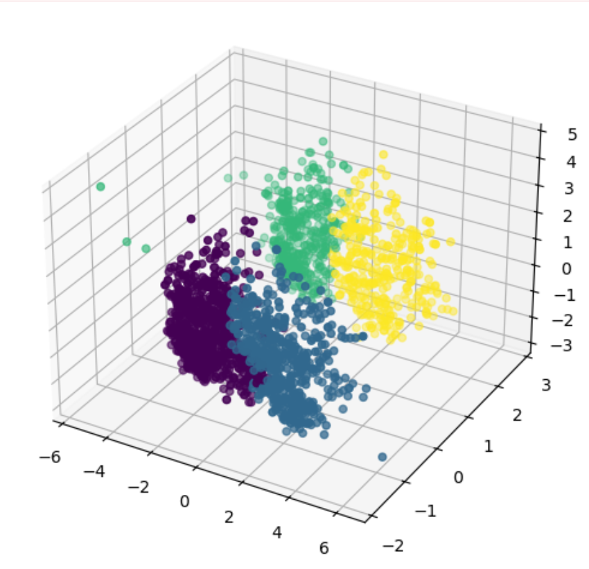
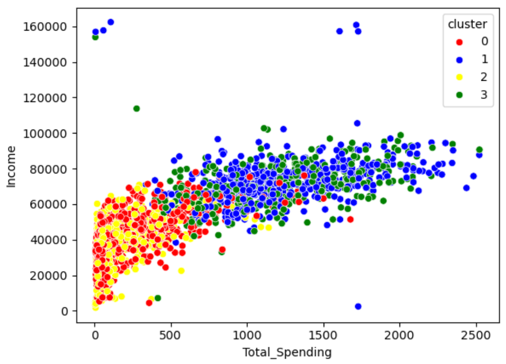
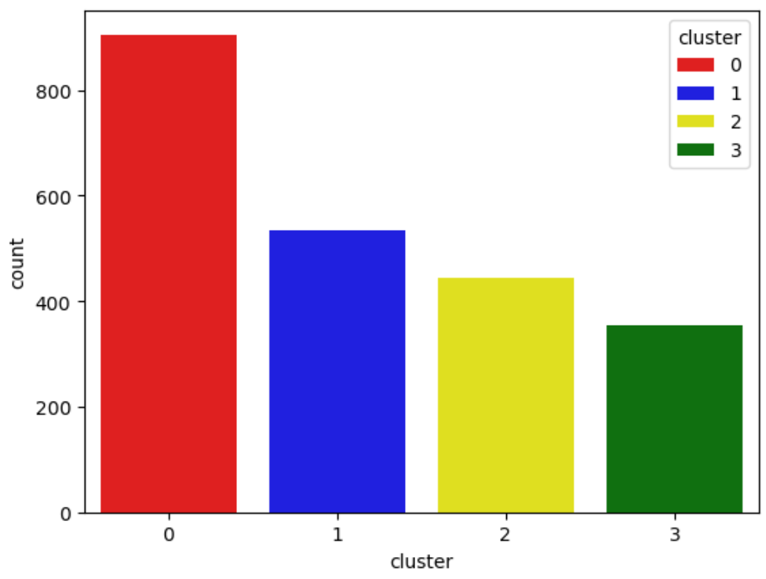
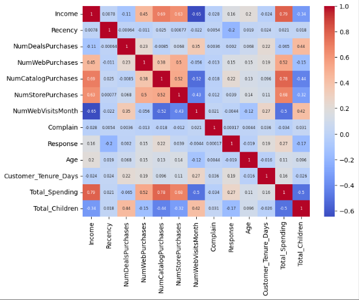
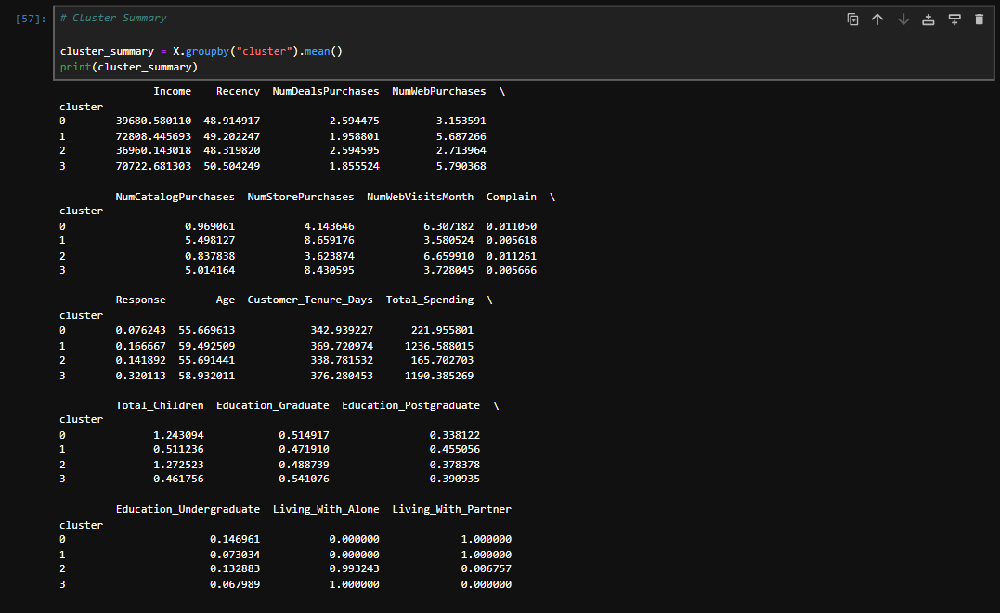

# 🛒 SmartCart — Customer Segmentation Using Clustering

An unsupervised machine learning project focused on customer segmentation, behavioural analysis, and discovering meaningful customer groups to support data-driven business decisions.

## 📌 Project Overview

SmartCart explores customer data to identify distinct customer segments using clustering techniques. The project combines data preprocessing, feature engineering, exploratory analysis, dimensionality reduction, and clustering to uncover patterns in customer characteristics and purchasing behaviour.

The objective is to understand how different customer groups vary in income, spending, household characteristics, and engagement.

## 🎯 Objectives

- Explore customer data and identify patterns.
- Perform data cleaning and preprocessing.
- Engineer meaningful customer features.
- Apply dimensionality reduction using PCA.
- Explore the optimal number of clusters.
- Apply and compare clustering algorithms.
- Interpret customer segments and derive business insights.

## 📂 Dataset

- **Original records:** 2,240
- **Original features:** 22
- **Records after preprocessing:** 2,236
- **Features after encoding:** 18

The dataset contains customer demographic information, household characteristics, income, purchase behaviour, campaign response and related customer attributes.

## ⚙️ Project Workflow

1. Data Loading and Exploration
2. Missing Value Treatment
3. Feature Engineering
4. Exploratory Data Analysis (EDA)
5. Outlier Analysis
6. Categorical Encoding
7. Feature Scaling
8. Principal Component Analysis (PCA)
9. Cluster Selection
10. Customer Segmentation
11. Cluster Analysis and Business Insights

## 🧹 Data Preprocessing & Feature Engineering

The project includes:

- Handling missing income values using median imputation.
- Converting customer dates into datetime format.
- Creating **Age** from birth year.
- Calculating **Customer Tenure**.
- Creating **Total Spending** across product categories.
- Calculating **Total Children**.
- Grouping education and marital status categories.
- Removing unnecessary columns.
- One-Hot Encoding categorical features.
- Scaling features using StandardScaler.

## 📉 Dimensionality Reduction — PCA

Principal Component Analysis (PCA) was used to reduce the dimensionality of the prepared data.

| Component | Explained Variance |
|---|---:|
| PC1 | 23.16% |
| PC2 | 11.39% |
| PC3 | 10.41% |
| **Total** | **44.91%** |

Three principal components were retained for dimensionality reduction and visualisation.

## 🔍 Clustering Methodology

The project explored the number of clusters using:

- Elbow Method
- Silhouette Score

The analysis indicated **4 clusters**.

### Algorithms Used

**K-Means Clustering**
- Number of clusters: 4
- Random state: 42

**Agglomerative Clustering**
- Number of clusters: 4
- Linkage method: Ward

The resulting customer clusters were analysed to understand differences in income, spending and customer characteristics.

## 👥 Customer Segments

The analysis identified four customer groups:

| Cluster | General Profile |
|---|---|
| Cluster 0 | Lower-income, lower-spending partnered customers |
| Cluster 1 | Higher-income, higher-spending partnered customers |
| Cluster 2 | Lower-income, lower-spending customers living alone |
| Cluster 3 | Higher-income, higher-spending customers living alone |

These profiles are interpretations of the cluster characteristics rather than predefined labels.


## 📊 Customer Segmentation Visualizations












## 💡 Business Insights

Customer segmentation can help businesses:

- Identify high-value customer groups.
- Develop targeted marketing campaigns.
- Personalise promotions.
- Better understand customer spending behaviour.
- Improve customer engagement.
- Support customer retention strategies.
- Make data-driven business decisions.

## 🛠️ Technologies Used

- Python
- Pandas
- NumPy
- Matplotlib
- Seaborn
- Scikit-learn
- Jupyter Notebook

## 📁 Repository Structure

```text
smartcart-customer-segmentation/
│
├── README.md
├── requirements.txt
├── Dataset/
├── Images/
└── Notebook/
```

## 🚀 Future Improvements

- Improve cluster validation and evaluation.
- Explore additional clustering algorithms.
- Analyse clusters using more detailed behavioural features.
- Develop an interactive customer segmentation dashboard.
- Translate cluster findings into actionable marketing strategies.

## 👨‍💻 Author

**Harsh Sharma**

M.Sc. Computer Science — Data Science & Machine Learning

GitHub: [hsbhardwaj](https://github.com/hsbhardwaj)

---

⭐ If you find this project interesting, feel free to explore the repository.
